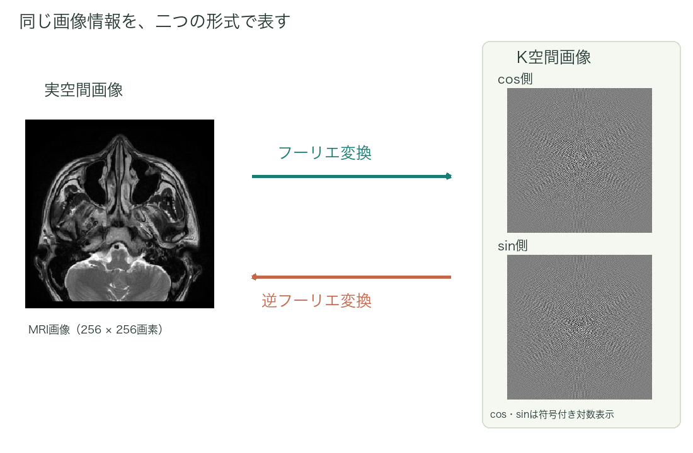

# 第2章　“画像”に必要な情報と表現形式

画像が持つ情報は、“どこにどのくらいの画素値が存在するか”という情報の集まりである。これを“各座標ごとの白さ・黒さ”（以降“明るさ”と表現する）で表現したものが、我々が普段見ている画像である。
これに付随して、誰の？とか、いつの？とか、なんという検査で得られた画像か？といった情報により、画像が解釈される（Aさんの2026年1月1日の上腹部MRI検査で、FSE法T2強調像のプロトコールで撮像している、などといった情報を前提として、目の前にある画像を解釈している）。

この画像に含まれた情報を表現する方法は1つに限らない。
もう1つの方法が、
“どの方向に、どのぐらいの細かさの波が、どのぐらいの大きさで、どのようなずれ方で含まれているのか”
というものである。波はcos波とsin波で表現される。細かさは周波数、波の大きさは振幅、ずれ方は位相と呼ばれる。位相に関しては、位相のずれがないsin波とcos波の足し合わせで表現できる。従って、画像を表現するのに必要な情報はsin波、cos波それぞれについて、どのぐらいの周波数の波がどれぐらい含まれているのか、となる。
“どの周波数の波が”を座標、“どのぐらいの大きさで”をその座標1マスの明るさと決めて、ひとまとまりのものとして表現した“画像”がk空間画像である。

*図2-1　MRI画像とK空間の2成分*

A：“どこにどのくらいの画素値が存在するか”
B：“どの方向に、どのぐらいの細かさの波が、どのぐらいの大きさで、どのようなずれ方で含まれているか”

AとBは、それぞれ同じ画像という情報の集まりを過不足なく表現することができるという意味で等価である。

ただし、一般的に画像はAの形式で表現され、解釈される。Bという表現方法（k空間画像）をそのまま見ても、何をみているのかさっぱり分からず、一般的には馴染みの少ないものである。
AからBへ、同じ情報の表現形式を変換するのがフーリエ変換であり、BからAへ戻すのが逆フーリエ変換となる。Aの形式で表現された画像を実空間画像、あるいは元画像と今後表現することにする。
ここでいう「実空間」は、位置を座標にした空間という意味である。4章末で補足する「実部」とは別の言葉なので、区別しておこう。

まずは、白黒画像一般について、この2つの表現形式を考える。実際のMRIでは、画像の明るさに加えて位相の情報も扱い、通常は再構成後の画像の大きさ（絶対値）を白黒で表示する。したがって、表示されたMRIの白黒画像をフーリエ変換しても、取得した生のk空間データがそのまま戻るわけではない。この点は、MRIとの対応を考える際の補足として覚えておけばよい。また、この補足がよく分からなくても全体の理解にとって大きな問題はない。

## 小括

- 画像は、“どこにどれだけの画素値があるか”という形でも、“どのような波がどれだけ含まれているか”という形でも表現できる。
- 両者を結ぶ操作がフーリエ変換、逆フーリエ変換である。

---
[文章と操作できる図を一緒に読む](../index.html#chapter-2)
