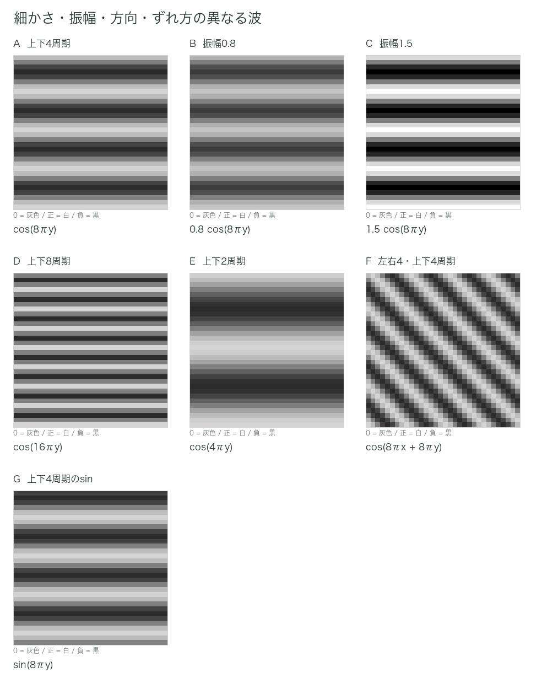
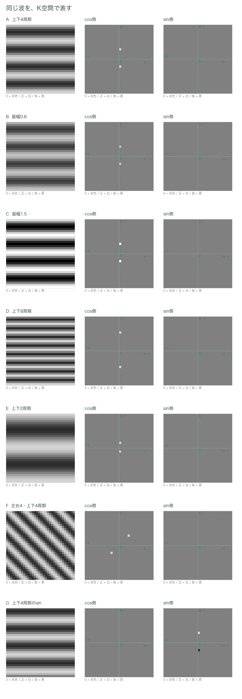
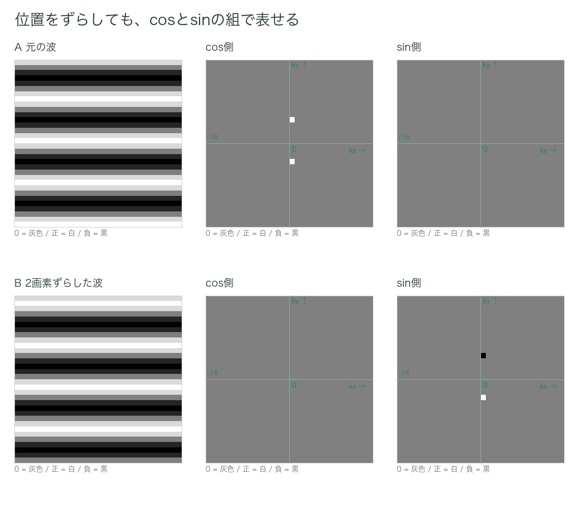

# 第4章　画像の周波数とK空間

ここで、画像についてのフーリエ変換を考えてみる。カラー画像ではなく、白黒の画像を考える。
解析する対象は、画像そのものである。2で述べた実空間画像である。もう少し具体的にいうと、特定の座標（画像の中での位置）にどのぐらいの画素値が格納されているか、という情報の集合である。
実空間画像における周期関数とは、いったいどのようなものかというと、白黒の繰り返しが作る波である。

まずは、元画像の中での波を見てみよう。左右をx軸、上下をy軸とする。cmなどの単位は決めず、座標軸の1目盛りを1とする。以下の例では、画像の幅、高さをそれぞれ1単位とし、各軸の0から1までの範囲を画像にする。
この画像を下から上まで眺めたときに、白黒の繰り返しが4周期あれば、y軸方向の空間周波数は4である。つまり、座標の1単位あたりに4周期の波がある、という意味である。時間あたりの波の数ではなく、距離あたりの波の数なので、空間周波数と呼ぶ。本稿ではこれを波数とも表現する。

振幅は、基準の値からどれだけ大きく上下するかを表す。画像として見ると、明暗の振れ幅に相当する。画像全体が明るくなることとは違う。
ここでいう波は、プラスとマイナスの値を持つ。図では0を灰色、プラスを白、マイナスを黒として表示する。黒が必ず0というわけではない。振幅の違いが見えるように、比較する画像では白黒に変換する範囲を揃える。

*図4-1　細かさ・振幅・方向・ずれ方を比べる*

Aのcos波は、原点で値が最大である。Gのsin波は、原点で値が0（灰色）である。同じ細かさでも、白黒の位置がずれていることがわかると思う。
この実例で、画像の周期関数が何となくわかったと思う。

今提示したのは、実空間画像上での周期関数である。次に、それぞれの波を短く表記してみよう。
x軸方向の空間周波数をk_x、y軸方向をk_yと表現すると、Aは、x軸方向には変化せず、y軸方向に4周期あるので、“(k_x, k_y) = (0, 4)、振幅1のcos波”と表記することができる。Fは、左右方向にも上下方向にも4周期あるので、“(k_x, k_y) = (4, 4)、振幅1のcos波”である。

フーリエ変換の大前提として、対象をたくさんの周期関数の足し合わせとして表現することができる、というものがあった。
たくさんの波を、“(k_x, k_y) = (0, 4)、振幅1のcos波”という表記の羅列で表現することもできるが、もう少しコンパクトな表現方法も存在する。
それは、k_x、k_yを座標軸とした座標平面を用意し、それぞれの波を掛けて積分した値を、対応する座標に格納するというものである。cos波を掛けて得られる値と、sin波を掛けて得られる値を、各座標にセットで記録する。
この座標空間をk空間と呼ぶ。記録した数値を白黒で表現すれば、これも画像の情報を表した一種の画像になる。これをk空間画像と呼ぶ。
本稿では、cos側の値とsin側の値を別々に白黒で表示する。2枚に見えるが、1つのk空間データを2つの成分に分けて見せているのであり、元画像の情報が倍になったわけではない。波を掛けて積分した値から、元画像を組み立てる際の係数がわかる。細かな換算は省略する。

*図4-2　それぞれの波に対応するK空間*

実数のcos波やsin波は、通常のk空間表示では、対応する正負の座標に一対の点として現れる。ただし、cos側とsin側で現れ方は異なる。具体的な値は次章の“掛けて足す”操作で確認する。

フーリエ変換の主張は、様々な周波数のsin波、cos波を足し合わせれば、対象を表現することができるというものであった。例えば、図4-1 Aの画像を少しずらしたものはどうだろうか。
Aの画像は、1単位の中に4周期あるので、

$$
f(x,y)=\cos(8\pi y)
$$

と表現できる。これをy軸方向に−1/16、つまり32×32画像の2画素分ずらすと、

$$
f'(x,y)=\cos\left(8\pi y+\frac{\pi}{2}\right)
$$

となる。加法定理を使うと、

$$
f'(x,y)=\cos(8\pi y)\cos\frac{\pi}{2}-\sin(8\pi y)\sin\frac{\pi}{2}
$$

と表現できる。cos(π/2)、sin(π/2)はそれぞれ一定の数値である。つまり、位置をずらした波も、基準の位置を決めたcos波とsin波の足し合わせで表せる。
一般に、ずれ方をθとすれば、cos(a + θ) = cos a × cos θ − sin a × sin θである。波のずれ方が変わっても、cos側とsin側に掛ける数値を変えればよい。このような波を色々な細かさ・方向で組み合わせることで、様々な画像の構造を表現できる。

*図4-3　2画素の位置のずれとcos・sinの組み合わせ*

どれだけのデータを記録するだろうか。例えば128×128の画像について、通常の完全収集を考えると、k空間には128×128のマスを用意し、各マスにcos側、sin側の値をセットで記録する。128×128点のデータであり、数値を1つずつ数えれば128×128×2 = 32,768個となる。

## 小括

- 画像の中での周期関数は、特定の方向に白黒が繰り返す波である。
- その細かさを空間周波数で表し、各方向の空間周波数をk空間の座標にする。
- 画像に波を掛けて積分した値を、対応するk空間座標に格納する。
- k空間の各マスにはcos側、sin側の値をセットで記録し、本稿では2枚の画像として表示する。

## 補足：cos側・sin側と、実部・虚部

一般的には、k空間の各マスに記録する2つの値を、1つの複素数としてまとめて扱う。本稿では、cos波を掛けて得た値を実部、sin波を掛けて得た値を虚部に対応させる約束にする。これはフーリエ変換の符号の取り方を1つに決めたもので、図や受信成分の向きもこの約束に合わせる。一般的な定義では、sin側の符号が本稿と反対になることがある。
実部と虚部という言葉を使っても、今回の一連の説明で行う“波を掛けて足し合わせ、その値を記録する”という操作は本質的に変わらない。複素平面に馴染みがなくても、cos側・sin側の2つをセットで記録する、と考えれば、この先の説明を進められる。本稿では引き続き、cos、sinで説明する。

---
[文章と操作できる図を一緒に読む](../index.html#chapter-4)
