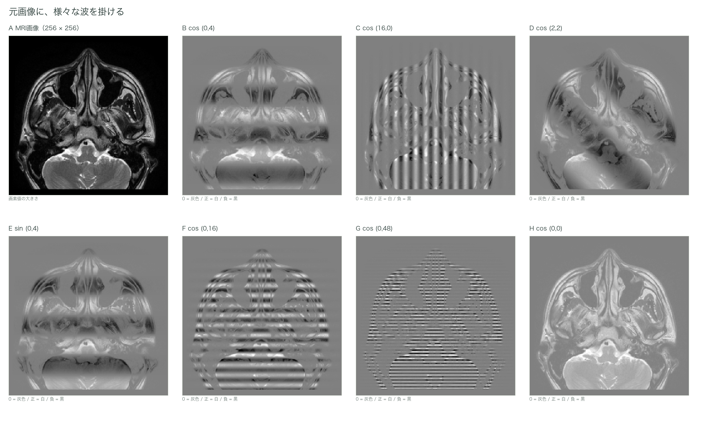
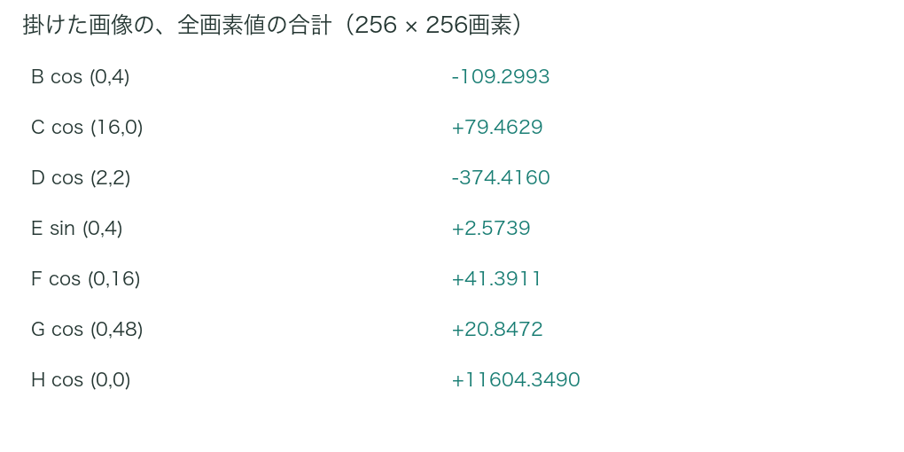
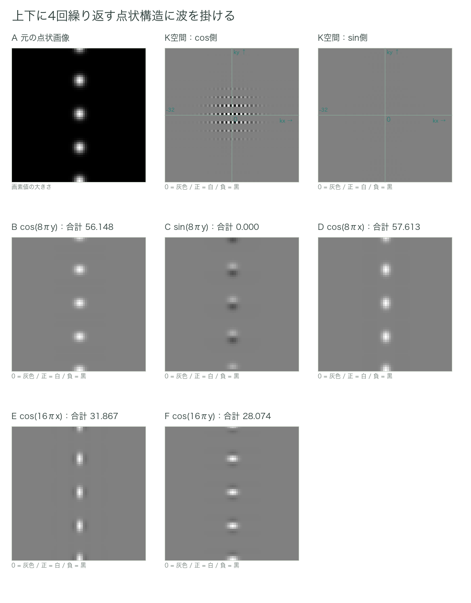
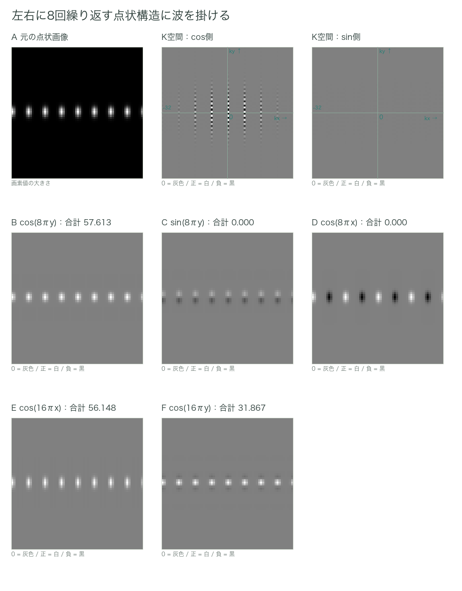
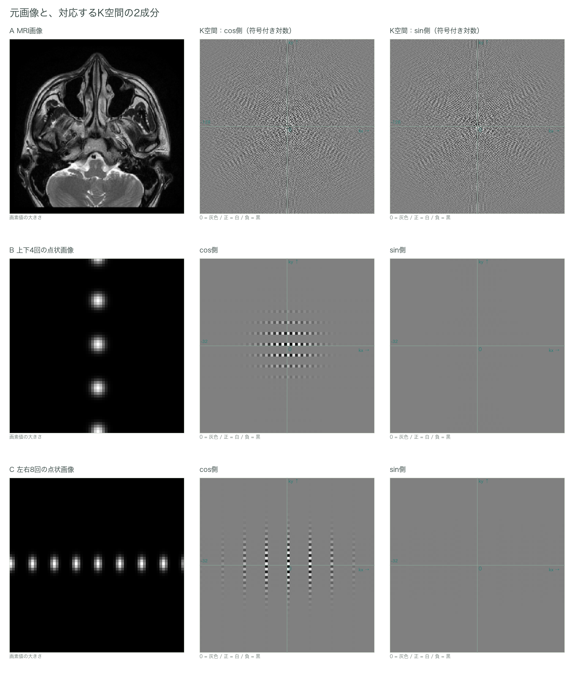

# 第5章　画像のフーリエ変換

フーリエ変換の基本的な構図を再度示す。

（解析したい対象）×（含まれる量を知りたい波）を積分する → その波がどれだけ含まれているかに関する情報

解析したい対象は元の画像、掛け合わせる波は、先に示した通り、空間的に分布する白黒の周期的な繰り返しであった。どの方向にどのぐらい細かく繰り返すかが空間周波数であり、基準の値からの明暗の振れ幅が振幅となる。
画像に周期関数を掛けるとは、具体的にどういうことであろうか。実例を見るとわかりやすい。

ここでも、元画像の各軸は0から1までとする。また、波はプラスとマイナスの値を持つ。掛け算した後の画像にも負の値が生じるため、計算結果の表示では0を灰色、プラスを白、マイナスを黒とする。比較する図の白黒の範囲は揃える。
大事なのは、画面上の白さを足すのではなく、元の符号つきの数値を足すことである。負の値を0に置き換えると、打ち消し合いの様子が変わってしまう。

*図5-1　元画像に波を掛けた結果*

B〜Hの画像が、それぞれ（解析したい対象）×（含まれる量を知りたい波）である。各画素に、その場所での波の値を掛けている。

積分はどうであろうか。結論からいうと、掛け算で出力された画像の、すべての画素値を符号つきで足し合わせればよい。有限個の画素を扱うここでは、この足し算が積分に相当する。元画像とk空間を行き来する際の全体の倍率は、一定の係数で調整する。
図5-1のB〜Hで、この合計値はどうなるであろうか。以降も、この合計を積分値と呼ぶことにする。

*図5-2　掛けた画像の全画素値の合計*

一般的な解剖画像では、低い空間周波数の成分が強く、高い空間周波数の成分が弱い傾向がある。ただし、周波数を上げれば必ず積分値が小さくなる、という規則ではない。実際の積分値は元画像と、掛け合わせる波によって決まる。
では、どのような場合に積分値の絶対値が大きくなるだろうか。
掛け合わせる波と同じ方向、細かさ、ずれ方の成分が、画像の中に多く含まれている場合である。反対の符号の成分が含まれていれば、大きな負の値として得られる。
具体例を見てみよう。

*図5-3　上下に繰り返す点状構造に波を掛ける*

元画像のk空間画像（cos側、sin側）も併せて示す。

*図5-4　左右に繰り返す点状構造に波を掛ける*

元画像のk空間画像（cos側、sin側）も併せて示す。

図5-3では、上下に4回繰り返す並びに対応するcos波を掛けたBで値が残る。一方、図5-4では、左右に8回繰り返す並びに対応するcos波を掛けたEで値が残る。周波数の高さだけでなく、方向やずれ方を含め、元画像にどの波の成分が含まれているかが重要である。
点の形そのものも色々な波の成分を含むので、それ以外の積分値が必ず全て0になるわけではない。k空間には、繰り返しの間隔に対応する位置だけでなく、点の形を表す成分も記録されている。
図5-3のCは、同じ細かさでも、掛ける波のずれ方が異なると積分値が0になる例である。cos側の値だけでは、一般的な画像を十分に表せないことがわかる。

つまり、画像に特定の波を掛けた後、全体を足し合わせるという一連の操作が、その波の成分を取り出すフィルターのような役割を果たす。掛け算した画像の一部が明るく見えることではなく、全体の合計としてどれだけ残るかが大事である。

*図5-5　元画像とK空間を対応させる*

図5-5に、今まで見た画像のk空間画像を示す。画像の中の繰り返し構造が、k空間では対応する決まった位置の値として表現される。4章で見た単一のcos波は正負の2点に現れたが、点状の画像では、その形を表すためにより多くの成分が必要となる。
まとめると、①画像に特定の空間周波数を持つcos波、sin波をそれぞれ掛ける→②それぞれの積分値を求める→③対応するk空間上の座標に2つの値をセットで格納する→④①〜③の操作を様々な空間周波数で行う、という操作でk空間にデータを充填する。
十分なデータが集まったものは、元画像と等価な情報を持つ。ただし、人間が見ても解釈は難しい。この実空間画像からk空間画像への変換が、画像のフーリエ変換となる。k空間画像を実空間画像に戻す操作が、逆フーリエ変換である。

## 小括

- 画像に対するフーリエ変換は、①特定の空間周波数のcos波・sin波を画像に掛け、②出来上がった画像の画素値を符号つきで足し合わせ、③その値を記録する、という操作を様々な空間周波数で行うことである。
- cos側とsin側の積分値を、対応するk空間座標にセットで格納する。
- k空間の数値を白黒で表したものをk空間画像と呼び、本稿ではcos側・sin側を別々の画像として表示する。
- 通常の完全収集では、元画像が256×256なら、k空間も256×256のマスとして扱う。
- 実空間画像からk空間画像への変換がフーリエ変換であり、その逆が逆フーリエ変換である。

---
[文章と操作できる図を一緒に読む](../index.html#chapter-5)
