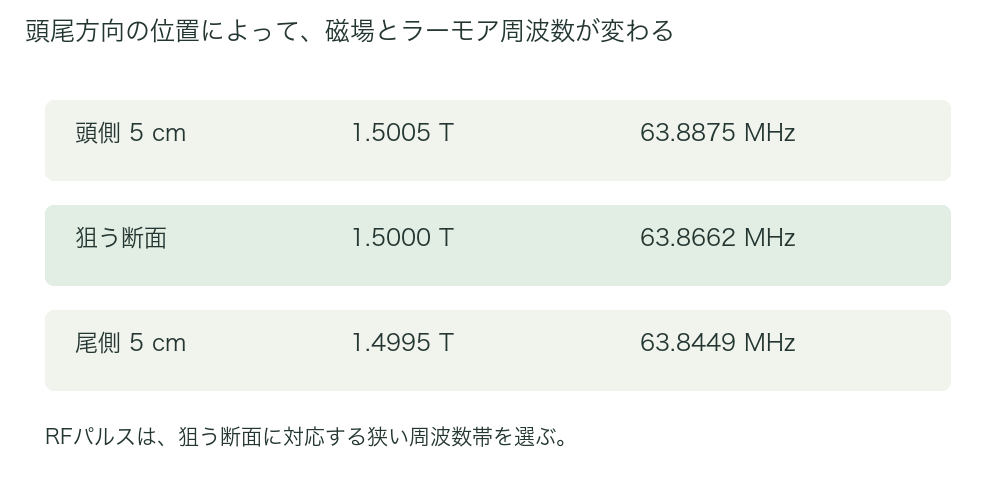
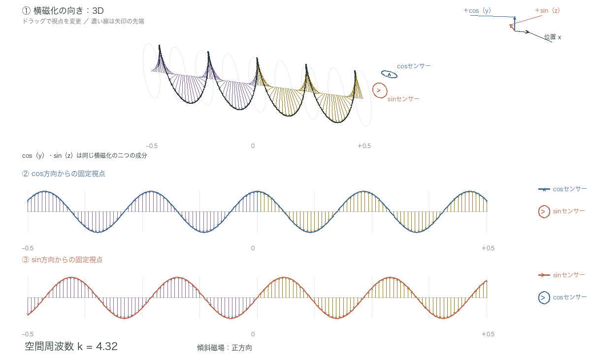
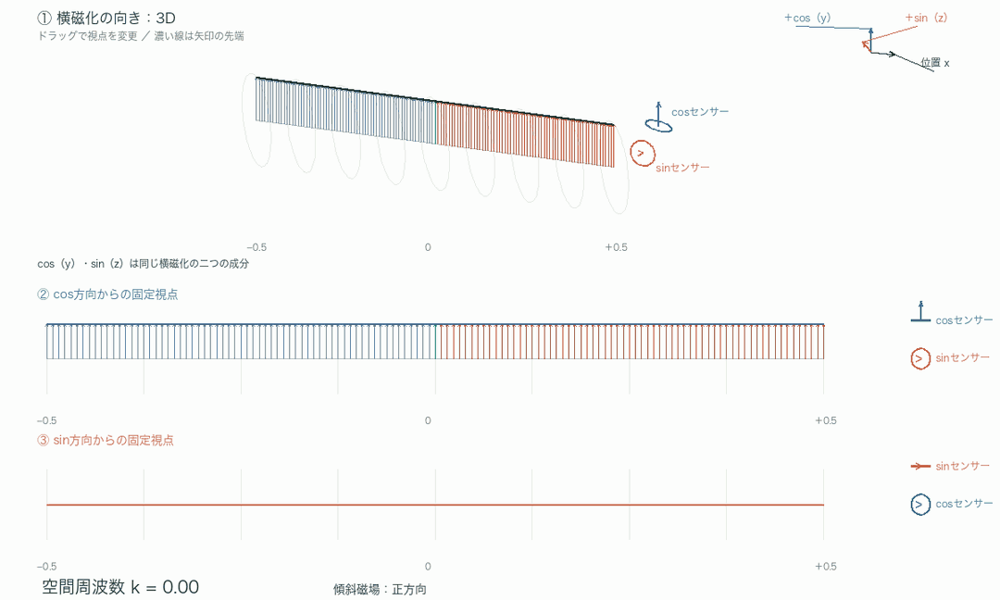

# 第7章　MR信号に位置情報を付加する

以降も基本的に回転座標系で議論する。前章の仮想センサーが出力する、巨視的磁化ベクトルのcos側・sin側の成分が、ここで扱うMR信号である。
前章ではMR信号の成り立ちを扱った。RFパルスを照射するとたくさんのICが横方向に倒れ、その横磁化がMR信号を生じるのであった。しかし、そのままでは、励起され、かつ受信コイルが感度を持つ範囲にある各場所からの信号が、全て重なって届く。
ここで、暗黙の前提を確認しておく。我々が最終的に欲しいのは画像である。つまり、どの位置のプロトンがどのような性質（プロトン密度、緩和時間など）を持つか、という情報である。そのためには、各部位からどれぐらいの大きさのMR信号が出ているかを知る必要がある。現在のままでは、感度範囲内の全ICの総和（巨視的磁化ベクトル）はわかっても、各部位がそれぞれどれぐらい寄与しているかはわからず、実空間画像に必要な情報は得られない。信号に位置情報を付加する必要がある。これを可能にするのが傾斜磁場である。

## 傾斜磁場

傾斜磁場とは、特定の方向の位置に応じて、静磁場方向の磁場の強さが直線的に変わるように加える磁場である。平たくいうと、例えば、右に行くほど強く、左に行くほど弱い磁場にする。x軸方向に沿って変える場合、追加する磁場と全体の磁場は、次のように表現できる。

$$
\Delta B_z=G_x x
$$

$$
B_z=B_0+G_x x
$$

B_0は元の静磁場、G_xは磁場の傾き（傾斜磁場の強さ、単位はT/m）である。
“x軸方向の傾斜磁場”とは、磁場の向きをx方向に倒すという意味ではなく、x方向の位置に応じて、静磁場方向の磁場の強さを変えるという意味である。
これを用いて、位置情報を付加する方法を考える。

## スライス選択傾斜磁場

まずは、スライス選択傾斜磁場を考える。ここでは、特定の断面を選んで撮像する、一般的な2次元撮像を考える。
例えば頭尾方向（z軸方向）に傾斜磁場をかけ、頭側ほど強く、足側ほど弱い磁場にする。基底核レベルの断面を狙うとして、その位置をz = 0とする。z = 0での磁場を1.5000 T、磁場の傾きを10 mT/m（0.010 T/m）とすると、

$$
B_z(z)=1.5000+0.010z\quad\text{[T、zはmで表す]}
$$

である。すると、狙う断面から頭側5 cmでは1.5005 T、尾側5 cmでは1.4995 Tとなる。通常のMRIで用いられる傾斜磁場の大きさの範囲で、説明しやすい値を選んでいる。
このとき、狙う断面でのラーモア周波数f_0 = (γ/2π) × 1.5000 Tを中心とする、狭い周波数帯のRFパルスをかける。プロトンではf_0は約63.87 MHzである。すると、この周波数帯に対応する薄い範囲のプロトンだけを励起し、そこから離れた部位は励起しないようにできる。
これで、「特定の断面からの信号である」という、1方向の位置情報は得られた。スライス厚やRFパルスの周波数帯の幅については、ここではこれ以上議論しない。イメージがつかめれば十分である。
かけた傾斜磁場と、励起に用いたRFパルスの情報を突き合わせれば、z軸方向のどの薄い範囲から得られた信号かがわかる。しかし、まだ、断面内のxy方向の位置を区別する情報は得られていない。

*図7-1　磁場の違いで、励起する断面を選ぶ*

さらに傾斜磁場を用いて、xy方向の位置情報を信号に付加する。これがエンコードである。ここから先が、ついに本題である。

## 傾斜磁場とエンコード

エンコードも傾斜磁場を用いて行う。エンコードは日本語では符号化であり、情報を特定の規則で別の情報に変換することである。傾斜磁場により位置情報を別の情報（具体的にはIC横磁化の位相）に変換している。まず、1次元で考える。2次元、3次元の場合も、この話の応用である。
x軸方向にICが分布している状況を考える。簡単にするため、ICは均一に分布しているとする。また、緩和はここでは無視する。出発点は、90°パルスをかけた直後のように、全てのICの横磁化が同じ大きさで同じ向きに揃った状態とする。ここに、x軸方向の傾斜磁場をかけ続けると、ICたちはどのような挙動をとるかを示す。

まったく傾斜磁場をかけない状況は、動画7-2の初期状態で確認できる。x軸はICの位置座標にとり、y軸とz軸でICの横磁化ベクトルを表現する。この動画のy軸、z軸は体内の位置ではなく、横磁化の2成分（前章のcos側、sin側）を表す軸である。特に、動画のz軸は、ここまで静磁場方向を指してきたz軸とは別物なので注意して欲しい。少しわかりにくいかもしれないが、x軸上の各座標に置かれたICが、x軸に垂直なyz平面内で単位円を描いて歳差運動しているところをイメージして欲しい。回転座標系で見ると、各ICは静止して見える。全てのICの向きが揃っているので、総和も最大のままである。当たり前だが、緩和を無視しているので、MR信号は一定のままである。緩和を考慮すると、MR信号はT2緩和時間を時定数として指数関数的に減少していく。
ここにx方向の傾斜磁場を加える。静止座標系で見ると、原点を挟んで、正方向のICは原点から離れるほど速く、負方向のICは原点から離れるほど遅く歳差運動することになる。これを、原点のICの周波数を基準とした回転座標系で眺める。原点のICは止まって見え、原点から離れたICほど速く回って見える。ただし、正方向と負方向では、回って見える向きが反対である。動画7-2に示す。

*図7-2　位置ごとの位相差と空間的な波*

3Dなので、方向を変えてみて欲しい。

動画7-2を一時停止し、xy平面、xz平面から眺めてみて欲しい。

傾斜磁場をかけ続けると、各ICの位相（単位円上のどの位置にいるか）に、位置に応じた差ができていく。その結果、回転座標系で見たICの横磁化の2成分（y成分とz成分、つまり検波後のcos側とsin側）に、位置に沿った波ができる。xy平面に投影するとcos波、xz平面に投影するとsin波である。この波の細かさは、空間上の波の数なので、4章で述べた空間周波数（波数）である。傾斜磁場をかけ続けると、空間周波数はどんどん増えていく。
次に、傾斜磁場を切る（印加を止める）とどうなるか。全てのICが再び同じ周波数で歳差運動するので、空間周波数はそれ以上増えも減りもしない。ただし、それまでにできた位相差、つまり波は、そのまま残る。
では、逆向きの傾斜磁場をかけるとどうだろうか。逆向きで同じ大きさの傾斜磁場をかけ続けると、空間周波数は減少していく。同じ時間だけかけたところで全てのICの位相が揃い、さらにかけ続けると、今度は空間周波数の符号が逆の波ができる。cos側の波は同じ形のまま、sin側の波の符号が反転した波である。
このように、傾斜磁場をかけると、回転座標系で見たICの横磁化の2成分それぞれに、位置に沿った波を作ることができる。これが本稿全体を通して最も重要な点である。注意して欲しいのは、ここで波を作ったのは空間的に分布するICの向きであるが、最終的なMR信号はその総和、すなわち巨視的磁化ベクトルである、という点である。すなわち、横磁化の2成分（動画7-2ではy方向とz方向）それぞれについて、全ICのベクトル成分を足し合わせたものがMR信号になる。次章では、この波を使って位置情報を取り出す、エンコードの実際を述べる。

## 小括

- MR信号に位置情報を付加するために、傾斜磁場が用いられる。
- 一般的な2次元撮像では、1方向の薄い範囲をスライス選択で決め、残り2方向の位置情報をエンコードする。
- 傾斜磁場をかけると、回転座標系で見た横磁化の2成分（cos側、sin側）に、位置に沿った波ができる。
- 傾斜磁場をかけ続けると波の数（空間周波数、波数）は増え続け、切ると変化しなくなる。逆向きにかけると減り、揃った状態を経て符号が反転する。
- MR信号はこの波そのものではなく、全ICを足し合わせた巨視的磁化ベクトルの各成分である。

---
[文章と操作できる図を一緒に読む](../index.html#chapter-7)
