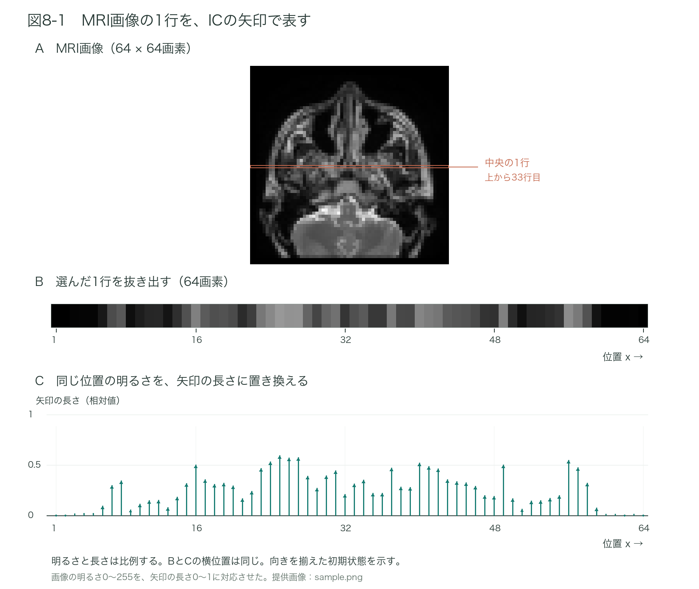
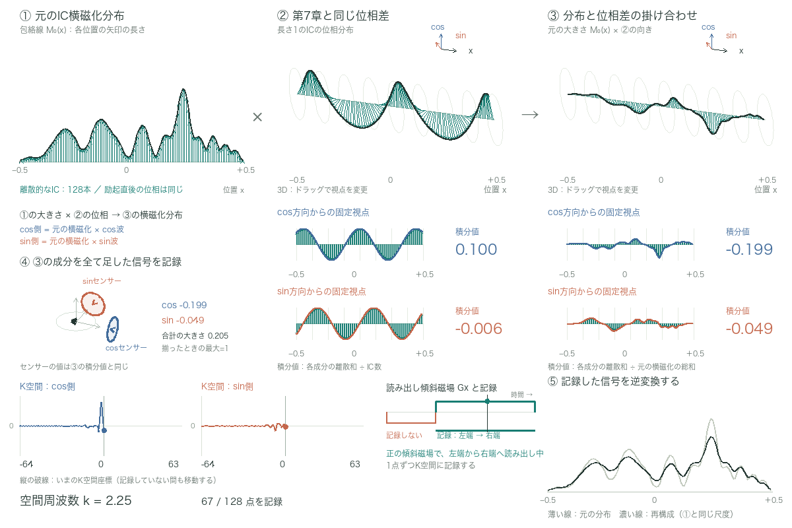
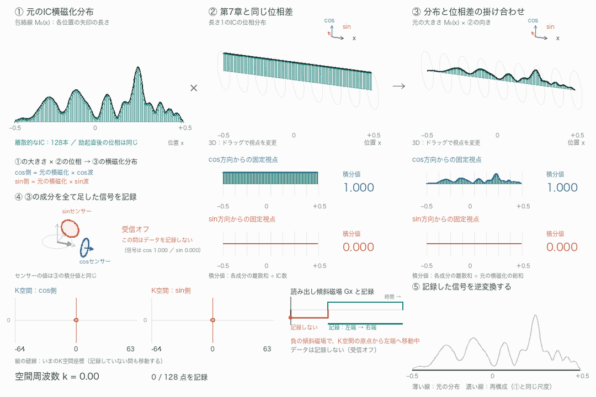

# 第8章　エンコードの実際

7章の例では、空間的に分布するICの横磁化の大きさを全て揃えていた。実際には、横磁化の大きさは、プロトン密度、T1緩和やT2緩和、撮像条件（TR、TEなど）に応じて、位置ごとに異なるのが普通である。これらの要素を加味して、その場所からどれだけの信号が出るかを、ここではICの矢印の長さで表す。これが、最終的に知りたい実空間画像の明るさに対応する。
実際の画像との対比でイメージを深めよう。まず1次元で考える。x軸方向のIC分布を画像化したものは、1方向に並んだ白黒のマス目の集まりとなる。イメージしやすいように、実際のMRI画像から1行を抜き出すことを考える。この白さ、黒さを、ICの矢印の長さで表現する（図8-1）。

*図8-1　MRI画像の1行を、ICの矢印で表す*

図8-1の画像上のラインを上下にドラッグすると、抜き出す行を変更できる。Bの画素列とCの矢印も、その行の明るさに合わせて変わる。

ここで押さえておきたいのは、次の3点である。
①最終的に知りたいのは、B、Cで表されるICの空間分布（どこに、どのぐらい）である。
②それを直接知ることは今のところできないが、全ICの横磁化の総和、すなわち巨視的磁化ベクトルは、MR信号として観測できる。
③伏線になるが、7章で見たように、傾斜磁場は、横磁化の2成分（cos側、sin側）に位置に沿った波を作ることができる。

実際の撮像では、場所ごとの初めの向きの違い、受信コイルの感度、収集中の緩和や動きなども考慮する必要があるが、ここでは、そうした影響を省いた理想化した条件で、仕組みを説明する。

ここで使えるのが、5章までで説明したフーリエ変換である。つまり

（解析したい対象）×（含まれる量を知りたい波）を積分する → その波がどれだけ含まれているかに関する情報

という関係である。
（解析したい対象）は、ICの空間分布、すなわち矢印の長さの分布である。
（含まれる量を知りたい波）は、傾斜磁場で作ることのできる波に相当する。
積分は、全てのICを足し合わせることに相当し、これは巨視的磁化ベクトル、つまり受信信号そのものである。
この対応を、ICの矢印で確かめてみよう。傾斜磁場で波を作った状態では、各ICの矢印は、長さがその位置の信号の大きさを、向きが位置に応じた位相を表している。したがって、矢印のcos側成分は（その位置の大きさ）×cos波、sin側成分は（その位置の大きさ）×sin波になっている。これを全ICについて足し合わせたものが、仮想センサーが出力する2つの値である。

つまり、傾斜磁場で波を作った状態でMR信号を収集し検波することは、対象の分布にcos波、sin波を掛けて積分する、という数学的操作そのものである。このとき掛けている波の空間周波数は、それまでにかけた傾斜磁場の方向、強さ、時間から、撮像する側が知っている。そこで、その時点の空間周波数に相当するk空間座標に、巨視的磁化ベクトルの成分の値（積分値）、つまりMR信号を格納する。これをさまざまな空間周波数について行えば、知りたかった情報、つまりIC空間分布をフーリエ変換したk空間画像を得ることができる。
k空間画像は、cos側、sin側の2枚がセットで得られる。目的のIC空間分布は、この2枚をセット（複素数）のまま逆フーリエ変換して得る。出力もcos側、sin側（実部、虚部）の2枚になるので、通常は各画素で二乗和の平方根（絶対値）をとり、1枚の画像として表示する。
つまり、MRIは、最終的に得たい画像をフーリエ変換したk空間画像を、直接撮像している。
このことを1次元で示したのが、動画8-2である。

*図8-2　元の横磁化分布に位相差を掛け合わせ、信号を記録する*

①元のIC横磁化分布、②7章で見た位相差（矢印の長さは全て1）、③①の大きさと②の向きを掛け合わせた磁化分布、を同じ位置軸で見比べる。元の横磁化分布には、ランダムで複雑な凹凸を持つものを用いる。③のcos側、sin側の成分をそれぞれ全ての位置で足した値が、受信信号としてk空間に記録される。異なる位相差の下で得た値を集め、逆フーリエ変換すると元の分布が再現される。

## ここまでのまとめ

- 画像のフーリエ変換は、“対象に波を掛け、その結果を全体にわたって足し合わせる”という操作を、様々な空間周波数で行うものである。
- MRI撮像では、傾斜磁場が磁化の空間分布に波を掛ける操作に相当し、各ICの矢印の足し合わせが受信信号に対応する。
- 信号はcos側、sin側の2成分をセットで記録する。
- 記録するk空間座標は、それまでにかけた傾斜磁場の方向、強さ、時間によって決まる。
- k空間画像は、cos側、sin側をセットのまま逆フーリエ変換し、得られた画像の絶対値を表示する。

上記を2次元に拡張しても、本質的には何も変わらない。2次元の特定方向に傾斜磁場をかけることは、画像のフーリエ変換において、特定の方向・細かさの波を掛けることに相当する。空間的に分布するICたちに、様々な方向、強さ、時間の傾斜磁場をかけ、信号を収集する。その信号を適切なk空間座標に配置し、逆フーリエ変換することで、欲しかったMRI画像を得ることができる。

では、周波数エンコードと位相エンコードは何であったか。
ここでは、k空間の格子を1行ずつ埋める、一般的な直交座標（Cartesian）収集を考える。周波数エンコード、位相エンコードという呼び分けを、この収集法の中での役割として眺めてみよう。

信号を収集している間、x方向の傾斜磁場を一定にかけ続ける。すると、x方向の位相差が変わり続け、対応するk空間の座標k_xも一定の速さで移動する。この間、信号を一定の間隔で取り続ければ、k空間の1行が埋まる。これが、周波数エンコードに相当する。以下では、この信号収集の期間を読み出しと呼ぶ。
各位置のICが異なる周波数で回り続けているので、受信信号の時間変化を周波数分析する、という見方とも結びつく。しかし、ここまでの説明に沿えば、“空間的な波を変えながら、その時々の足し合わせを測っている”と理解できる。

このとき、事前にx方向の位相差を作らずに読み出しを始めると、k_x = 0から正負どちらか一方へ進む。正負の両側を測るには、読み出しの前に逆向きの傾斜磁場をかけ、負側へ移動しておけばよい。
7章で見たように、傾斜磁場の向きを逆にすると、中心より右側が速く、左側が遅くなるという関係が逆になる。その結果、中心のICに対して、どちら側のICがどれだけ進むか・遅れるかも反対になる。これが、k空間の正負に対応する。同じ大きさの正負の空間周波数では、cos波の形は同じだが、sin波の符号が反対になる。cos側とsin側をセットで記録することで、この違いも表すことができる。

具体的には、まず負の傾きの傾斜磁場（ΔB_z = −G_x x、G_xは正の値）を一定時間かける。次に、正の傾きの傾斜磁場（ΔB_z = G_x x）をかけながら読み出す。すると、負のk_xから始まり、k_x = 0を通り、正のk_xまで、1行をたどることができる。例えば、読み出しと同じ強さの負の傾斜磁場をかける時間を読み出し時間の半分にしておけば、読み出しのちょうど中央でk_x = 0を通る。逆向きの傾斜磁場を先にかけるのは、このように読み出しの出発点を用意するためである。強い信号を見つけてk空間の中心へ置き直す、という操作ではない。

ただし、このままでは、直交するy方向のk空間座標は変わらず、同じ行しか測れない。測る行を変える必要がある。
そこで、読み出しの前に、y方向の傾斜磁場を一定時間だけかける。これによって、y方向にも位置に応じた位相差ができ、k_yが変わる。7章で見た通り、傾斜磁場を切っても位相差は残るので、読み出し中にy方向の傾斜磁場をかけ続ける必要はない。
その状態でx方向の傾斜磁場をかけながら読み出すと、k_yが一定のまま、k_xだけを変えて1行を埋められる。読み出す前にy方向の位相差を作り、どの行を埋めるかを決める操作が、位相エンコードに相当する。
y方向の傾斜磁場の強さや時間、正負を変えれば、別の行を選べる。励起と読み出しを繰り返し、そのたびに位相エンコードの量を変えることで、k空間全体を埋めていく。
なお、位相エンコードをかけた行では、k_x = 0を通るときもk_yは0ではない。k空間の原点を通るのは、位相エンコードの量が0、つまりk_y = 0の行を測るときだけである。

周波数エンコードという名前は、読み出し中の位置ごとの回転周波数の違いに注目した名前であり、位相エンコードという名前は、読み出し前に作って残しておく位相差に注目した名前である。
本稿で伝えたいのは、どちらも、“傾斜磁場によって、横磁化の向きに位置ごとのずれを作る”という同じ操作だということである。信号を測る間もずれを変え続けて1行をたどるか、測る前にずれを作って行を選ぶか、という使い方の違いがあるだけである。名前を覚える前にこの共通の仕組みをイメージできれば、位相エンコードだけを別の難しいものとして考える必要はない。
k空間の埋め方には、この他にも色々なものがある。ここで説明した1行ずつの収集は、その代表的な方法である。

## 小括

- 各ICの矢印は、長さがその位置の信号の大きさを、向きが傾斜磁場で作った位相を表す。その総和が受信信号であり、“分布に波を掛けて積分した値”そのものである。
- MRIは、最終的に得たい画像をフーリエ変換したk空間画像を、直接撮像している。
- 周波数エンコードは、読み出し中に傾斜磁場をかけ続けてk空間の1行をたどる操作、位相エンコードは、読み出し前に位相差を作って行を選ぶ操作である。
- どちらも、傾斜磁場で横磁化の向きに位置ごとのずれを作る、という同じ操作である。

## 補足：今回の説明の範囲

傾斜磁場とk空間の移動は、RF励起後に180°パルスを挟まない単純な例で説明した。スピンエコーのように180°パルスを挟む場合には、そこで位相が反転し、k空間座標の符号も反転することを考慮する必要がある。
また、フーリエ変換と逆フーリエ変換の呼び分けには、式の符号の約束が関わる。本稿では、磁化の空間分布からk空間データへの変換をフーリエ変換、そのデータから実空間画像へ戻す操作を逆フーリエ変換と呼んでいる。教科書によっては、受信信号を“フーリエ変換して”画像を得ると書かれているが、これは呼び方の約束の違いであり、画像再構成の仕組みが異なるわけではない。

---
[文章と操作できる図を一緒に読む](../index.html#chapter-8)
